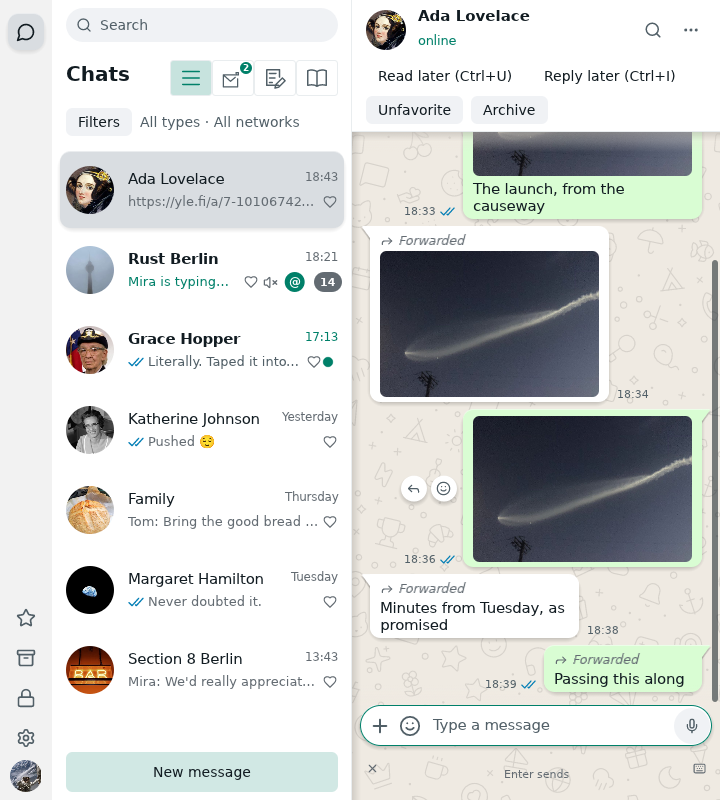

# Message times

Ordinary and linked timelines show a date separator for each day. Their message
metadata therefore uses the local clock only, respecting the OS 12/24-hour
setting (15:23 in a 24-hour region). No redundant short date is drawn per bubble.

The clock and existing metadata sit outside the bubble toward the conversation
centre: right of received messages, left of sent messages, aligned with the
bottom. Space is reserved before wrapping the body. The same rule covers text,
media, captionless pictures and albums. Albums keep the last member's metadata;
failed individual album items retain an error badge. Metadata uses the panel's
colours, not the outgoing bubble's contrast colours.

Hovering the time shows the full local date, time, seconds and zone. Sent-message
time/status still opens Message info. Standalone search results, copied messages
and message info keep their dated timestamps because they lack this transcript's
date context. No archive data or timestamps are rewritten.

## Narrow light-theme example

The bundled offline demo, with clocks outside photos and bubbles:

